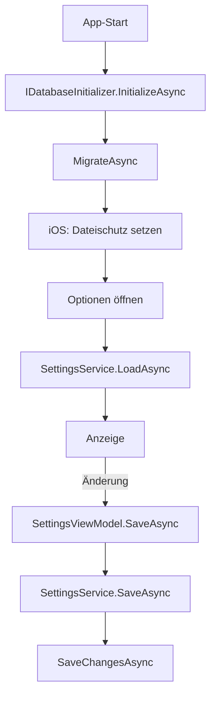

← [Zurück zur Übersicht](index.md)

# Einstellungen — Technischer Ablauf

## Übersicht

Die Einstellungen liegen in einer einzigen lokalen SQLite-Datenbank (`tankatlas.db`), angesprochen über Entity Framework Core 10.0.10 (`Microsoft.EntityFrameworkCore.Sqlite`) im Projekt `Tankradar.MAUI` (Ordner `Data/`). Das Schema wird ausschließlich über Migrationen verwaltet (kein `EnsureCreated`). Der Zugriff der UI erfolgt über `ISettingsService`; die ViewModels kennen keine EF-Typen.

## Ablauf

### 1. App-Start und Datenbankinitialisierung

1. `MauiProgram.CreateMauiApp()` registriert `IDatabaseFileProtector`, `IDatabaseInitializer`, `IDbContextFactory<TankradarDbContext>` (Pfad aus `IAppDataPathProvider.GetDataDirectory()` + `tankatlas.db`, dadurch greift die Testisolation über `TANKATLAS_TEST_DATA_PATH`) und `ISettingsService`.
2. Der `App`-Konstruktor stößt `IDatabaseInitializer.InitializeAsync()` ohne Warten an.
3. `DatabaseInitializer` legt das Datenverzeichnis an und ruft `Database.MigrateAsync()` auf: Beim ersten Start wird die Datenbank angelegt, bei einem App-Update werden nur ausstehende Migrationen angewendet, vorhandene Daten bleiben erhalten.
4. `IDatabaseFileProtector.Protect(...)` setzt unter iOS `NSFileProtectionCompleteUntilFirstUserAuthentication` auf Verzeichnis, `tankatlas.db`, `-wal` und `-shm` (`#if IOS`); auf anderen Plattformen geschieht nichts. Es gibt keine zusätzliche Verschlüsselung.
5. Der Initialisierungs-Task wird zwischengespeichert; bei einer Ausnahme wird er verworfen, sodass ein späterer Zugriff die Initialisierung wiederholt.

### 1a. Einrichtung beim ersten Start

1. `App.CreateWindow` erzeugt `AppShell` über die Fabrik `Func<AppShell>` aus der Dependency Injection. Die Shell erhält `ISetupStatusService`, `SetupViewModel` (Transient) und `ILogger<AppShell>` (`MauiProgram`: `AppShell` als Transient, `ISetupStatusService` → `SetupStatusService` als Singleton).
2. Nach dem Laden der Shell (`Loaded`) ruft `AppShell.CheckSetupAsync()` `ISetupStatusService.IsSetupRequiredAsync()` auf. `SetupStatusService` wartet auf denselben Lauf von `IDatabaseInitializer.InitializeAsync()` (kein Rennen mit der Migration) und prüft, ob in `UserSettings` die Zeile `Id` = `UserSettingsEntity.SingletonId` existiert. Fehlt sie, ist die Einrichtung nötig.
3. `AppShell` erzeugt aus dem `DataTemplate` `SetupOverlayTemplate` (`AppShell.xaml`) eine `ContentPage` mit `SetupViewModel` als `BindingContext` und legt sie per `Navigation.PushModalAsync` über Shell und TabBar (keine Route, kein Systemdialog, siehe [ADR 0017](../../adr/0017-einrichtungsdialog.md)). Ein Fehler bei Prüfung oder Anzeige wird protokolliert; die Einrichtung erscheint dann nicht.
4. `SetupViewModel` zeigt `FuelTypes` aus `AppSettings.CreateDefault()` (alle ausgewählt, Reihenfolge E5, E10, Diesel; `FuelTypeItemViewModel` ohne Verschiebe-Schaltflächen). `SaveAsync()` prüft „mindestens eine Sorte“ (sonst `StatusMessage`, kein Speichern) und speichert `AppSettings.CreateDefault()` mit der Auswahl über `ISettingsService.SaveAsync` (inkl. `Validate`). `SkipAsync()` speichert `AppSettings.CreateDefault()`. Bei Erfolg löst es `Completed` aus, `AppShell` entfernt die Seite (`PopModalAsync`, nur wenn sie die oberste Modalseite ist, sonst wird ein Hinweis protokolliert); bei einem Fehler bleibt sie mit `StatusMessage` offen.
5. Ab jetzt existiert die Zeile `UserSettings`; `IsSetupRequiredAsync()` liefert bei jedem weiteren Start `false`. Es gibt kein eigenes Kennzeichen, keine Migration und keine Schemaänderung.

Bewusst hingenommene Folgen:

- **Bestandsinstallationen:** Die Zeile `UserSettings` entsteht nur durch `SettingsService.SaveAsync`. Installationen, die nur aktualisiert wurden und nie in den Optionen gespeichert haben, sehen die Einrichtung nach dem Update einmalig. Es gibt keine Datenmigration.
- **Wiederherstellung:** `BackupViewModel.Restored` lädt nur die Einstellungen neu; der Einrichtungsstatus wird nicht gesondert behandelt. Enthält die wiederhergestellte Datenbank die Zeile, bleibt die Einrichtung aus; fehlt sie, erscheint die Einrichtung beim nächsten Start.

### 2. Einstellungen laden

1. `SettingsPage` erscheint, `SettingsViewModel.OnAppearing()` startet `LoadAsync()`.
2. `SettingsService.LoadAsync()` wartet auf die Initialisierung und liest `UserSettings` (Zeile mit `Id` = 1) sowie alle `FuelTypeSettings` (sortiert nach `SortOrder`).
3. Mapping auf das Domänenmodell `AppSettings`: Fehlende Zeilen oder ungültige Enum-Texte ergeben Standardwerte (`AppSettings.CreateDefault()`); unbekannte Spritsorten-Schlüssel werden ignoriert, fehlende `FuelType`-Werte ans Ende angehängt; sind keine Sorten gespeichert oder keine ausgewählt, gilt die Standardauswahl.
4. `AppSettings.ShowNearby` kommt aus `UserSettings.ShowNearby` (fehlende Zeile: `false`); `SettingsViewModel.ShowNearby` löst beim Umschalten ein Speichern aus, `ShowNearbyGpsHint` zeigt den Hinweis bei `GpsUsage.Never`. Das ViewModel befüllt `FuelTypes`, `GpsOptions`, `ViewOptions`, `SortOptions` mit unterdrücktem Speichern. Bei einer Ausnahme erscheint `StatusMessage`, es werden die Standardwerte angezeigt und nichts gespeichert.

### 3. Änderung und sofortiges Speichern

1. Ein `Switch`, `RadioButton` oder ▲/▼ löst eine Änderung im Element-ViewModel (`FuelTypeItemViewModel`, `ChoiceOptionViewModel<T>`) aus.
2. Das Abwählen der letzten ausgewählten Spritsorte wird zurückgenommen und mit `StatusMessage` gemeldet; es wird nicht gespeichert.
3. `SettingsViewModel.SaveAsync()` (serialisiert über `SemaphoreSlim`, letzter Stand gewinnt) ruft `ISettingsService.SaveAsync(AppSettings)`.
4. `SettingsService.SaveAsync` validiert, lädt die Zeilen, patcht sie (Load-and-Patch, `SortOrder` = Position, `IsSelected`), legt fehlende Zeilen an und führt genau ein `SaveChangesAsync` aus (atomar). Unbekannte vorhandene Schlüssel bleiben unverändert.

## Datenmodell

| Tabelle | Inhalt |
|---------|--------|
| `UserSettings` | Eine Zeile (`Id` = 1): `GpsUsage`, `ResultView`, `ResultSortOrder`, `ShowNearby` (Schalter „In der Nähe“, Standard `false`) |
| `FuelTypeSettings` | Eine Zeile je Spritsorte: `FuelTypeKey` (Primärschlüssel), `SortOrder`, `IsSelected` |

Enum-Werte werden als Text (Enum-Name) gespeichert: `FuelType` (`SuperE5`, `SuperE10`, `Diesel`), `GpsUsage` (`Always`, `WhileInUse`, `Never`), `ResultView` (`List`, `Map`), `ResultSortOrder` (`Price`, `Distance`, `Name`). Die Namen sind ein Persistenzvertrag und durch Tests festgeschrieben. Standardwerte stehen im Code, nicht in Migrationen.

Migrationen liegen unter `src/Tankradar.MAUI/Data/Migrations/` (`InitialCreate`, `AddFuelTypeSettings`, `AddPriceCache`, `AddFavorites`, `AddNearbySetting`, `AddVehicles`). `AddNearbySetting` ergänzt `UserSettings.ShowNearby` (`INTEGER NOT NULL`, Standard 0); bestehende Einstellungen bleiben erhalten. `AddVehicles` legt die Tabellen des [Tankbuchs](../Tankbuch/ablauf-technisch.md) an (`Vehicles`, `TankbookEntries`), ohne bestehende Tabellen zu ändern. Neue Migration: `dotnet ef migrations add <Name> --project src/Tankradar.MAUI --framework net10.0-windows10.0.19041.0` (Design-Time-Fabrik `TankradarDbContextFactory`). Das Projekt hat mehrere Zielframeworks; ohne `--framework` bricht `dotnet ef` ab.

## Beteiligte Komponenten

- `TankradarDbContext`, `UserSettingsEntity`, `FuelTypeSettingEntity`, `TankradarDbContextFactory`
- `IDatabaseInitializer` / `DatabaseInitializer`, `IDatabaseFileProtector` / `DatabaseFileProtector`
- `ISettingsService` / `SettingsService`, `AppSettings`, `FuelTypeSelection`
- `SettingsViewModel`, `FuelTypeItemViewModel`, `ChoiceOptionViewModel<T>`, `SettingsPage`
- `SettingsTexts` (zentrale UI-Texte, `Resources/Texts/`)
- Einrichtung beim ersten Start: `ISetupStatusService` / `SetupStatusService`, `SetupViewModel`, `SetupTexts`, `AppShell` (`SetupOverlayTemplate`, `CheckSetupAsync`), `App.CreateWindow`
- `IAppDataPathProvider` (einzige Quelle des Datenbankpfads)

## Fehlerbehandlung

- Fehler beim Laden: Meldung „Die Einstellungen konnten nicht geladen werden.“, Standardwerte, kein Speichern.
- Fehler beim Speichern: Meldung „Die Einstellung konnte nicht gespeichert werden.“
- Eine fehlgeschlagene Initialisierung wird nicht dauerhaft gecacht und beim nächsten Zugriff wiederholt.
- Fehler bei der Erststart-Prüfung oder beim Anzeigen der Einrichtung: Protokolleintrag, die Einrichtung erscheint nicht, die Shell bleibt bedienbar.
- Fehler beim Speichern der Einrichtung: Meldung „Die Einrichtung konnte nicht gespeichert werden. Bitte versuche es erneut.“, die Einrichtung bleibt offen.

## Tests

- Unit: `SettingsService`, `SettingsViewModel`, Enums
- Integration: echte SQLite-Datei, Erststart, Migration älterer Schemastände, Neustart
- Unit: `SetupViewModelTests_Selection`, `SetupViewModelTests_Validation`, `SetupViewModelTests_Save`, `SetupViewModelTests_Skip`
- Integration: `SetupStatusServiceTests_FirstStart` (frische Datenbank, nach dem Speichern, nach einem Neustart)
- E2E (FlaUI): Einstellungen ändern und App neu starten; `E2ETestBase` isoliert über `TANKATLAS_TEST_DATA_PATH`. Fehlt vor dem Start die Zeile `UserSettings`, beendet `E2ETestBase` die Einrichtung nach dem Start über „Überspringen“ (`CompletesSetupOnStart`, Standard `true`); `SetupE2ETests_*` schalten das ab und prüfen Erscheinen, Speichern, Neustart, Überspringen, Validierung, Änderung in den Optionen und Wiederherstellung

## Hinweis zu iOS

Das Dateischutzattribut ist nur auf einem iOS-Gerät prüfbar; der Code wird vom iOS-Build in CI kompiliert. Datenbankdateien (`*.db`, `*.sqlite*`) dürfen nicht committet werden (Hook).
