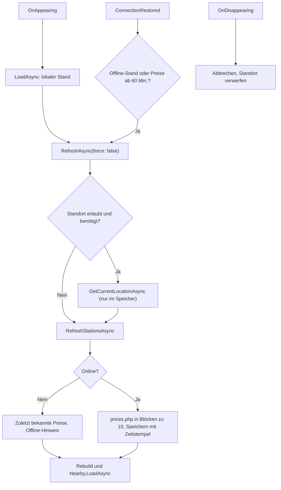

← [Zurück zur Übersicht](index.md)

# Startseite — Technischer Ablauf

## Übersicht

`FavoritesPage` / `FavoritesViewModel` (Route `favorites`) bilden die Startseite. Beim Erscheinen wird zuerst der lokale Stand aufgebaut (`LoadAsync`), danach aktualisiert (`RefreshAsync(force: false)`). Die Aufbereitung übernimmt `HomeOverviewBuilder`, die Preisaktualisierung `IFuelPriceService.RefreshStationsAsync`, der optionale Bereich `NearbySectionViewModel`. Entscheidungen und Abweichungen vom Entwurf: [ADR 0007](../../adr/0007-home-page-design-deviations.md).

## Ablauf

### 1. Erscheinen der Seite

`FavoritesViewModel.OnAppearing` meldet sich bei `IConnectionMonitor` (`ConnectionChanged`, `ConnectionRestored`) an, setzt den Offline-Zustand und startet `LoadAndRefreshAsync` (auch nach der Rückkehr aus Gruppen- oder Detailansicht).

### 2. Lokaler Stand

`LoadAsync` lädt `AppSettings` (`ISettingsService`), `IFavoritesService.GetOverviewAsync` (alle Gruppen mit Einträgen; Gruppen nach Namen, Einträge nach Priorität absteigend, dann Name) und `IFuelPriceService.GetKnownStationsAsync` (lokale Tankstellen mit letzten Preisen, ohne Abruf). Verworfen wird das Ergebnis, wenn zwischenzeitlich ein neueres Laden begonnen hat (`_loadVersion`). `HomeOverviewBuilder.Build` erzeugt `HomeGroup`/`HomeStation`: Preiszeilen und Hinweise über `StationResultBuilder.BuildItem` (nur ausgewählte Sorten in Einstellungsreihenfolge, `PriceFreshness`, `StationHints`), Entfernung nur bei vorhandener Position (`PriceRepository.DistanceKm`; Position oder Tankstelle auf (0, 0) ergibt keine Entfernung). Ist eine Tankstelle lokal unbekannt, erscheint sie mit Name und Adresse aus dem Favoriteneintrag ohne Preise.

### 3. Aktualisierung

`RefreshAsync(force)` bricht einen laufenden Abruf ab (`CancellationTokenSource`) und setzt `IsBusy`.

1. Standort: nur wenn `GpsUsage.AllowsLocation()` und Bedarf besteht (Favoriten-Tankstellen vorhanden oder `ShowNearby`); `ILocationService.GetCurrentLocationAsync`, Fehler ergeben `LocationStatus.Unavailable`. Der Standort liegt nur im Feld `_position` (Arbeitsspeicher). Wird die Seite während der Ermittlung verlassen, wird der Vorgang abgebrochen und der Standort nicht mehr übernommen.
2. Preise: `FuelPriceService.RefreshStationsAsync(ids, force)` normalisiert die Kennungen (UUID, doppelte werden ausgelassen; keine Obergrenze, abgerufen wird in Blöcken zu 10) und ruft nur Tankstellen ab, die ohne `force` nicht innerhalb von `PriceApiOptions.CacheLifetime` (Standard 5 Minuten) erfolgreich aktualisiert wurden (`_refreshed`, nur im Speicher). Offline (`IConnectionMonitor.IsOnline` falsch) folgt sofort der Rückfall `PriceDataSource.OfflineFallback`. Sonst ruft `TankerkoenigClient.GetPricesAsync` in Blöcken zu höchstens `MaxPriceIds` = 10 den Endpunkt `prices.php?ids=…` ab, `PriceRepository.SavePricesAsync` speichert jeden Preis mit Zeitstempel, die abgerufenen Preise ersetzen je Sorte die lokalen. Ergebnis: `StationRefreshResult` (`Stations`, `Source` = `Live`/`Cache`/`OfflineFallback`, `Failure`). Ein `PriceApiException` bricht den Abruf ab und liefert die zuletzt bekannten Preise.
3. Anzeige: `Rebuild` setzt `Groups`; `StatusMessage` stammt aus `SearchTexts.GetFailureMessage`; `Nearby.LoadAsync(settings, location, token)` lädt den Bereich neu.
4. Abschluss: `UpdateOfflineState` setzt `IsOffline` (keine Verbindung, Rückfall der Favoriten oder des Bereichs „In der Nähe“), `OfflineMessage` = `SearchTexts.OfflineBanner`.

`RefreshCommand` („Preise aktualisieren“) ruft `RefreshAsync(force: true)` nur bei `CanRefresh` (online und nicht beschäftigt).

### 4. Wiederverbindung

`OnConnectionRestored` aktualisiert (`force: false`), wenn der letzte Abruf ein Rückfall war, eine Gruppe veraltete Preise enthält (`HomeGroupViewModel.HasStalePrice`, ab 60 Minuten) oder `Nearby.IsOfflineResult` gilt; danach entfällt der Offline-Hinweis. `ConnectionChanged` aktualisiert nur den Offline-Zustand.

### 5. Verlassen der Seite

`OnDisappearing` meldet die Ereignisse ab, bricht laufende Abrufe ab, löscht `IsBusy` und setzt `_position` auf `null`. Der Standort wird nie in der Datenbank abgelegt und nie protokolliert (Protokolle nennen nur Ausnahmetypen). Der Suchcache `FuelPriceService._searchCache` (Schlüssel mit auf ca. 110 m gerundeter Position, nur Arbeitsspeicher) verliert abgelaufene Einträge (`CacheLifetime`, 5 Minuten) bei jedem Aufruf von `SearchNearbyAsync`, `RefreshStationsAsync` und `GetKnownStationsAsync`.

### 6. Navigation

Kachel (`StationTile`: `TapGestureRecognizer` und Schaltfläche „Details öffnen“) ruft `HomeStationViewModel.OpenCommand`; `IStationNavigator.OpenDetailAsync(StationListItem)` öffnet die Detailansicht, ein Mehrfachauslösen wird per `_isOpeningStation` unterdrückt. `OpenGroup` ruft `IFavoriteGroupNavigator.OpenGroupAsync`. Änderungen am Favoritenbestand (`IFavoritesService.Changed`, schwach über `FavoritesChangeSubscription`) laden die Seite neu.

### Bereich „In der Nähe“

`NearbySectionViewModel.LoadAsync` blendet den Bereich aus, wenn `AppSettings.ShowNearby` falsch ist oder `GpsUsage.AllowsLocation()` nicht gilt. Ohne Position erscheint `SearchTexts.GetLocationMessage`, ohne gewählte Sorte eine leere Liste. Sonst `IFuelPriceService.SearchNearbyAsync` mit `StationSearchQuery` (Radius `SearchRadius.Default` = 5 km, gewählte Sorten); `StationResultBuilder.Build` filtert (Chip, `FuelFilterOptionViewModel`), sortiert nach Entfernung und begrenzt auf `MaxItems` = 10. Es gibt keine Favoritenaktion; `OpenStation` öffnet die Detailansicht.

## Einstellung und Daten

`AppSettings.ShowNearby` (Standard `false`) wird in `UserSettings.ShowNearby` gespeichert (Migration `AddNearbySetting`, Spalte `INTEGER NOT NULL`, Standard 0; bestehende Zeilen bleiben erhalten, Test `NearbySettingMigrationTests_Upgrade`). Neue Tabellen sind nicht nötig; Gruppen und Einträge: [Favoritengruppen](../Favoriten/ablauf-technisch.md), Preise: [Kraftstoffpreise](../Preisdaten/ablauf-technisch.md).

## Fehlerbehandlung

- Laden der Gruppen schlägt fehl: `FavoritesTexts.LoadFailed`, Protokoll nur mit Ausnahmetyp.
- Preisabruf nicht möglich (offline, Schlüssel fehlt/abgelehnt, Dienst nicht erreichbar): zuletzt bekannte Preise, Meldung aus `SearchTexts.GetFailureMessage`, Offline-Hinweis; keine Ausnahme für die Oberfläche.
- Speichern der abgerufenen Preise schlägt fehl: Protokoll, die frischen Preise werden trotzdem angezeigt und gelten nicht als aktualisiert.
- Standort nicht verfügbar: Meldung nur im Bereich „In der Nähe“, Favoriten ohne Entfernung.
- Detailansicht nicht verfügbar: `DetailTexts.NotAvailable`.

## Tests

Unit (`HomeOverviewBuilderTests_Content`, `FavoritesViewModelTests_Home`, `FavoritesViewModelTests_Reconnect`, `NearbySectionViewModelTests_Section`, `FuelPriceServiceTests_RefreshStations`, `TankerkoenigClientTests_Prices`, `SettingsViewModelTests_Nearby`), Integration (`PriceRefreshMockServerTests_Flow`, `HomePrivacyTests_Persistence`: Standort nicht in der Datenbank, `NearbySettingMigrationTests_Upgrade`), FlaUI (`HomeE2ETests_*` mit `MockTankerkoenigServer` und `TANKATLAS_TEST_LOCATION`).
